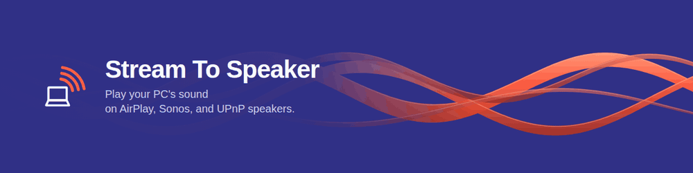

[](https://github.com/Mihonarium/StreamToSpeaker/actions/workflows/build.yml)
[](LICENSE)
[](LICENSE-BINARIES.md)

Stream To Speaker adds a virtual audio output to Windows and streams it over
the network — to Sonos, IKEA SYMFONISK, KEF, Denon HEOS, MoOde and Volumio
over **UPnP / OpenHome**, and to HomePod, AirPort Express and shairport-sync
over **AirPlay**. Windows volume and the speaker's own buttons stay in sync.
It also has experimental support for **Sendspin** (Music Assistant's
streaming protocol): it can stream to Sendspin speakers and offer the PC's
sound to Music Assistant as an input (optional, off by default).

## Install

*Directly or from the Microsoft Store.*

**[⬇ Download](https://github.com/Mihonarium/StreamToSpeaker/releases/latest/download/StreamToSpeakerSetup.exe)**
and run it. Needs Windows 10 1809+ / Windows 11, x64 (not ARM64 or Windows Server).

<a href="https://apps.microsoft.com/detail/xpfm3gjl2tdg30?referrer=appbadge&mode=full" target="_blank"  rel="noopener noreferrer">
	
</a>

## Use

1. Set **Stream To Speaker** as the Windows audio output — or route a single
   app to it in the Volume Mixer.
2. Pick a speaker in the app.

Sonos speakers grouped in the Sonos app show up as one entry ("Living Room +
Kitchen"); audio plays on the whole group and the volume slider moves the
group volume. To stream to a single speaker, ungroup it in the Sonos app.

Sound lagging behind video → **−25 / −100 ms**. No sound → **Resync**
(`Ctrl+Shift+R`). Speaker missing → **↻ Rescan**; check it's on the same
network as the PC.

Sendspin support is experimental and off by default: tick *Enable Sendspin*
in the *Sendspin and Music Assistant* card to list Sendspin speakers and offer
the Music Assistant input. Sendspin speakers play directly, without Music
Assistant. One that asks to be paired shows or says a code (or has one printed
on it): type it in when the app asks; it's remembered.

**Music Assistant input (experimental):** tick *Offer this computer as a Music Assistant input*
and enable the Sendspin Source plugin in Music Assistant. The first time, open
this computer in Music Assistant's player settings and run its setup; the app
shows a 6-digit code to type in there. After that, select *Music Assistant* in
the speaker list to send the PC's audio there; it gets audio only while that is
selected. Music Assistant chooses the speaker: set *Automatically play line-in
on* in this computer's player settings there, or play the input from Browse.
Music Assistant finds the computer by itself only on the same network. If it
runs on another one (another VLAN or subnet), add the computer's address, shown
in the card while it waits, under *Manual IP addresses for discovery* in the
Sendspin provider's settings in Music Assistant; it then connects to port 8928
on the computer, so that port must be free and a firewall between the networks
must let the connection through.

Closing the window minimises to the tray; quit from the tray menu.

Speakers that stream over UPnP fetch the PC's audio from a plain HTTP URL on
the PC. By default any device on the same network can play whatever the PC
plays from that URL, from the moment the app starts (before you pick a
speaker) and whichever speaker you play on — AirPlay, HomePod, Sendspin and
Music Assistant included — unless you turn streaming off.
**Advanced → Privacy mode** serves that URL only to the speaker you're
streaming to and the other speakers of its Sonos group (as grouped when you
picked it): their addresses are allowed for as long as the session lasts, and
switching speakers cuts off anything still listening from the old one. A
refused device is named in a message, so you can tell a phone from a speaker;
if a speaker stays silent (one grouped after you picked the group, say), pick
it again or turn privacy mode off. AirPlay, Sendspin and Music Assistant
playback doesn't use the URL, so privacy mode never affects it. Disabling
streaming or forgetting the speaker closes the URL to every other device
either way.

**Control from your phone:** in Settings, turn on *Control from your phone*,
then scan the QR code or choose *Copy link*. Anyone with the link can switch
speakers and change the delay on your network. *Make a new link* replaces it.
For a headless or service install, `stream-to-speaker.exe --web-link` prints
the link when run as the app’s Windows account.

For scripts, turn on *Let scripts and home automation control this app* and
choose *Copy key*. The API accepts either enabled key. With both controls off
it returns 404. With either on, a missing or incorrect bearer key gets 401.
See [TECHNICAL.md](TECHNICAL.md#http-api).

Once a day the app asks GitHub whether a newer release exists and, if so,
shows a link to it. Nothing is downloaded or installed by itself. Turn the
check off under **Advanced** if you'd rather not.

## CLI flags

```
--headless                No GUI; run as a CLI service.
--no-tray                 GUI window only, no tray icon.
--web                     Enable phone control and its HTTP/JSON API.
                          The window shows the link, and --headless prints
                          it once at start.
--web-link                Print the web UI's link and exit — for headless and
                          service installs. Run it as the account the app
                          runs under, with the app's --port / --advertise-ip.

--source <auto|driver|wasapi-loopback|sine>
                          Audio input. Default 'auto': kernel driver, falling
                          back to WASAPI loopback.

--player <name-or-ip>     Speaker to play on, any kind: its address, its full
                          name, or part of a name. The app starts anyway.
                          After the first search (a few seconds) it takes the
                          best match: that address, else that full name, else
                          a shown speaker whose name contains it; if none
                          matches yet, the first that does later. Omit to keep
                          the last place. A headless terminal also offers a
                          picker.
--no-interactive          With --headless, don't ask in the terminal.
--list-speakers           Search for speakers, print them and exit.
--no-discovery            Skip discovery; only serve HTTP.

--port <N>                TCP port. Default 5901.
--bind <ip>               HTTP bind address. Default 0.0.0.0.
--advertise-ip <ip>       IP to give every speaker, to search from and to
                          put in the web UI's link. Default: per speaker,
                          this PC's address on that speaker's network;
                          search on every interface; in the link, the address
                          worked out when it is shown.

--silence-pace-ms <N>     Pacing of silence packets. Default 10 (real-time);
                          higher drains the speaker's buffer between tracks.
--rate-fudge-ppm <N>      Clock-skew compensation. Default 0.
--latency-adjust-step-frames <N>
                          Frames added or dropped per packet while adjusting
                          latency. Default 4.
--no-silence-injection    Don't inject a low noise floor during silence.
--silence-packets-threshold <N>
                          Consecutive silent packets before quiescence.

--ssdp-interval <N>       Minutes between re-discoveries; 0 counts as 1.
                          Default 5.
--log-level <level>       error / warn / info / debug / trace. Default info.
```

Tuning the last group: [TECHNICAL.md](TECHNICAL.md#latency-control).

## Verifying a download

```
gh attestation verify StreamToSpeakerSetup.exe -R Mihonarium/StreamToSpeaker
```

proves the file was built by this repository's CI from a specific commit.
Offline: `--bundle <file>.sigstore.json`, shipped with each release.

The driver is [certified by Microsoft](https://partner.microsoft.com/en-us/dashboard/hardware/Driver/DownloadCertificationReport/95342530/14599256519720956/1152921505701928485).

From the next release on, the Microsoft-signed driver inside each release installer is checked against a rebuild from this source by the [Driver reproducibility](.github/workflows/driver-reproducibility.yml) workflow before the installer is signed (the installers of v0.1.6, v0.1.9 and v0.1.10 were checked afterwards by the same workflow), and each installer build logs which driver package it bundled. (Pre-releases built with the test-signed driver, which needs testsigning mode, skip that check.)

## Developers

Architecture, building from source, HTTP API: [TECHNICAL.md](TECHNICAL.md).
Driver signing pipeline: [docs/driver-signing.md](docs/driver-signing.md).

## License

Source [MPL-2.0](LICENSE). Released binaries: free to install and use,
no redistribution or modification — [LICENSE-BINARIES.md](LICENSE-BINARIES.md).

Driver scaffold derives from Microsoft's sysvad sample (MIT); UPnP/SSDP
patterns from [swyh-rs](https://github.com/dheijl/swyh-rs) (MIT).
